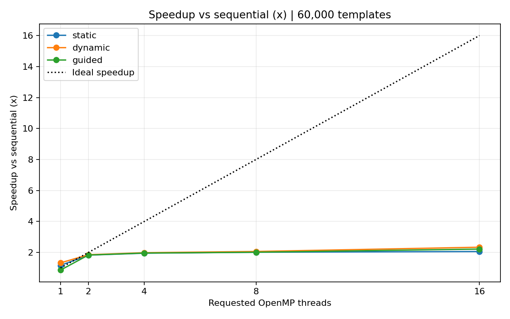

# Load-Balanced Parallel Fingerprint Identification using OpenMP

An educational **C11/OpenMP project** for exploring parallel search, loop scheduling, and load balancing on multicore CPUs. It compares a query fingerprint (represented by minutiae) against a database and tests different loop scheduling policies.

## Files

- `fingerprint_omp.c` — complete standalone C11/OpenMP implementation (sequential baseline; parallel static, dynamic and guided; early cancellation; results and per-thread CSV).
- `prepare_socofing.py` — optional `.BMP` -> grayscale raw -> WSQ -> NIST MINDTCT `.xyt` conversion and manifest creation, **requires Pillow and NBIS utilities**.
- `plot_results.py` — plots speedup, efficiency, early-stop savings and per-thread matching time.
- `tests/test_smoke.py` — automated smoke tests for synthetic and `.xyt` inputs.

## 1. Compile

Linux/WSL, or MSYS2 UCRT64 on Windows with a GCC compiler:

```bash
gcc -O2 -std=c11 -Wall -Wextra -fopenmp fingerprint_omp.c -o fingerprint_omp -lm
```

On Windows, name the output `fingerprint_omp.exe` and run `./fingerprint_omp.exe` from MSYS2 or `.\fingerprint_omp.exe` from PowerShell.

Use a GCC installation with its OpenMP runtime and thread libraries installed. No Python packages are needed to run the C program on synthetic data. If an older MinGW installation fails with `cannot find -lpthread`, its toolchain is incomplete; use a complete GCC/OpenMP installation. The Makefile targets a POSIX shell (Linux, WSL, or MSYS2).

Optional Python helpers require Python 3.10+; install both dependencies with:

```bash
python -m pip install -r requirements.txt
```

## 2. Quick start (no dataset required)

```bash
./fingerprint_omp --synthetic 6000 --query-index 1500 --threads 4 --schedule static --early 0 --repeats 5
./fingerprint_omp --synthetic 6000 --query-index 1500 --threads 4 --schedule dynamic --early 0 --repeats 5
./fingerprint_omp --synthetic 6000 --query-index 1500 --threads 4 --schedule guided --early 0 --repeats 5
./fingerprint_omp --synthetic 6000 --query-index 1500 --threads 4 --schedule dynamic --early 1 --threshold 100 --repeats 5
```

Each invocation overwrites `results.csv` and `thread_results.csv`, so change `--csv` and `--thread-csv` if keeping separate results. The full benchmark below includes all combinations in one set of CSVs. On Windows, elapsed time uses the high-resolution performance counter because older MinGW OpenMP runtimes can return non-monotonic `omp_get_wtime()` intervals; other platforms use `omp_get_wtime()`.

**Synthetic templates** contain between 20 and 80 random minutiae. High-workload templates are deliberately clustered at the start to demonstrate why contiguous static partitioning can become imbalanced. The gallery query exactly matches one stored template, so an early threshold of **100** is appropriate for the demonstration.

## 3. Full experimental grid

```bash
./fingerprint_omp --benchmark --synthetic 6000 --query-index 1500 --repeats 5 \
  --csv results.csv --thread-csv thread_results.csv
```

This automatically runs:

| Factor | Values |
|---|---|
| Database size | 6,000; 30,000; 60,000 |
| Threads | 1; 2; 4; 8; 16 |
| Scheduling | static; dynamic; guided |
| Early stopping | off; on |
| Repetitions | 5 |

The query and baseline are held constant within each size. A gallery query index wraps modulo the smaller of the base size and current gallery size, so it always selects an existing template. Results include execution time, full-search speedup (`sequential time / parallel time`, only for early stopping OFF), efficiency (`speedup / actual threads`), end-to-end speedup (also reported for early stopping ON), number of comparisons, best-match and candidate identity, score, and correctness flags. Per-thread statistics include comparisons and measured time inside the matcher. The CSV also records `accepted` and `reference_accepted` according to the threshold. The remaining wall time is recorded as **idle + scheduler/parallel overhead estimate**, not an exact measurement of idle time. If no candidate meets the threshold, early-stop mode completes a full search and records a non-accepting result. The plotting workflow expects accepting early-stop rows, as produced by the stored-gallery demonstration.

**Note:** 16 software threads will not necessarily be faster if your CPU has fewer cores. Results on tiny datasets can be dominated by thread-startup overhead.

## 4. Create the graphs

```bash
python -m pip install matplotlib
python plot_results.py --results results.csv --threads thread_results.csv --output plots
```

Outputs include `speedup_<size>.png` and `efficiency_<size>.png` (full searches only), `end_to_end_speedup_<size>.png`, `early_stop_savings_<size>.png`, `execution_time_comparison_<size>.png`, `comparisons_early_stop_<size>.png`, `database_size_vs_execution_time_T<threads>.png`, and per-thread load/idle-estimate graphs when data is available. The plotting script rejects invalid or non-positive timing records and checks full-search and early-stop result validity before graphing.

## 5. Run on actual SOCOFing fingerprints (optional)

Download the **SOCOFing** dataset yourself and use its `Real/` BMP images. A source link is available in the SOCOFing research paper: [SOCOFing research paper](https://irep.ntu.ac.uk/id/eprint/34744/). It contains 6,000 original prints. **It is not included in this project archive.**

The C matcher consumes NIST `.xyt` files with one minutia per line:

```
100 120 45 85
103 157 90 80
208 195 180 92
```

The columns are `x y angle quality`; the demonstration matcher uses x/y/angle. A tiny *example* manifest and three handmade `.xyt` files are included for testing this input format:

```bash
./fingerprint_omp --manifest examples/manifest.txt --query-index 1 --threads 2 --schedule dynamic --early 1 --repeats 1
```

Those example templates are just test numbers, **not real fingerprint minutiae**. You can supply `.xyt` files from an existing extraction workflow, or generate them using the optional Python script:

```bash
python -m pip install pillow
python prepare_socofing.py --images /path/to/SOCOFing/Real --output data/xyt --limit 6000
```

The script requires both **NIST NBIS `cwsq` and `mindtct`** executables installed and available in `PATH`; see the [NIST NBIS project page](https://www.nist.gov/services-resources/software/nist-biometric-image-software-nbis). The steps it executes for each BMP are:

1. Read with Pillow and convert to an 8-bit grayscale raw pixmap.
2. `cwsq 0.75 wsq IMAGE.raw -raw_in WIDTH,HEIGHT,8,PPI` to encode WSQ.
3. `mindtct IMAGE.wsq OUTPUT_PREFIX` to generate `OUTPUT_PREFIX.xyt`.
4. Save all successful `.xyt` file paths in `data/xyt/manifest.txt`.

**Caution:** NIST MINDTCT does **not** directly accept BMP/PGM; the WSQ conversion is needed. SOCOFing images can be small, so NIST MINDTCT may fail or extract few minutiae from some images. The extraction script records failures instead of claiming all prints were successfully processed. The default `--ppi 500` is an assumed metadata value; it is not a way to improve native image resolution.

Run using the manifest:

```bash
./fingerprint_omp --manifest data/xyt/manifest.txt --query-index 100 \
  --threads 4 --schedule dynamic --early 1 --threshold 100
```

The `manifest.txt` contains absolute file paths, so it can be used from any working directory on the **same computer**. Using `--benchmark --manifest data/xyt/manifest.txt` will reuse templates to reach 30,000 and 60,000 gallery entries.

Alternatively, to query a separate template not in the gallery:

```bash
./fingerprint_omp --manifest data/xyt/manifest.txt --query-file my_query.xyt \
  --threads 8 --schedule guided --early 0
```

For the strict benchmark, a stored-gallery query is preferred because it has a known exact match.

## 6. How each stage works

1. **Extract minutiae** once using NIST tools (or generate synthetic minutiae).
2. **Sequential:** loop through all gallery prints, calculate `match_score`, keep highest score (ties -> lowest index).
3. **Parallel:** use `#pragma omp parallel` and `#pragma omp for schedule(runtime)`; select the policy with `omp_set_schedule()`.
4. **Avoid races:** maintain per-thread best scores, merge with an OpenMP critical section.
5. **Early stopping:** after a score reaches the threshold, an atomic stop flag asks other threads to skip remaining work; OpenMP `cancel for` and `cancellation point` accelerate termination if enabled. For OpenMP cancellation support, set `OMP_CANCELLATION=true` before launch; atomic-flag fallback still works otherwise.
6. **Measurements:** exclude dataset extraction/loading. The sequential timer covers the full matching loop; the parallel timer covers the OpenMP parallel region, including matching and its scheduling/synchronization overhead. Per-thread busy time measures time inside individual matcher calls. Results are compared to the sequential reference and stored in CSV files.

### Why early-stop results can differ from full search

A parallel thread finding score 75 before another finds score 95 can legitimately return the score-75 candidate if threshold is 70. Therefore **early stopping at a threshold below 100 does not guarantee the globally highest score**. The CSV has separate `same_identity` and `same_exact_best` flags, so discrepancies are visible. If the gallery query is an exact stored template and threshold is 100, any accepting score is maximal, though duplicate gallery copies can yield different matched indexes for the same identity. We do **not** misrepresent a threshold match as necessarily the global optimum.

### Matching limitations

This project implements a simple greedy, one-to-one positional/angular minutiae matcher. It is not invariant to translation/rotation or calibrated as a secure real-world biometric system. It is intended for studying OpenMP scheduling and load balancing. On independently captured or altered prints, performance may be poor; do not use it for security decisions or people-identification in practice.

## 7. Smoke tests

```bash
python tests/test_smoke.py
```

The tests always compile the current C source into a temporary directory. They check all three schedules with early stopping on/off, manifest reading, benchmark query wrapping when the base exceeds the gallery size, and extreme-coordinate matching. They leave local executables and benchmark results untouched. Set `CC` to a compiler executable path to override `gcc`. Tests require Python 3.10+ and a working GCC/OpenMP toolchain; they do not require Python packages or NBIS.

GitHub Actions runs the tests on Linux with `OMP_CANCELLATION` both enabled and disabled, and checks a small plotting workflow.

## 8. Reproducible results

The repository includes the saved sample benchmark outputs:

- [results.csv](results.csv): 450 measurements across three database sizes, five thread counts, three schedules, early stopping on/off, and five repetitions.
- [thread_results.csv](thread_results.csv): per-thread comparison counts, matching time, and idle-plus-overhead estimates.
- [All 25 plotted graphs](plots/README.md): execution time, speedup, efficiency, early stopping, and thread balance.



These are the existing saved outputs, preserved unchanged rather than rerun after the source fixes. The original run did not record complete hardware/compiler/runtime metadata, so treat the timings as illustrative samples. Timings are hardware-dependent; synthetic results do not measure real-world identification accuracy. Per-match timing instrumentation adds overhead to the parallel run.

Use the full benchmark command in section 3 and plotting command in section 4 to produce a new run. These commands overwrite the tracked sample files; use `--csv`, `--thread-csv`, and the plotter's `--output` option to save separate outputs. For future comparisons, record your CPU, operating system, compiler version and flags, OpenMP runtime/settings, and exact benchmark command.

## 9. Publishing on GitHub

Use the directory containing this README as the repository root. The source, handmade examples, tests, dependency list, license, and GitHub Actions workflow belong in the repository. The sample CSVs and plots are tracked. The `.gitignore` excludes local executables, caches, result backups, and datasets. Keep downloaded biometric data outside the repository.

To upload through the GitHub website, use the contents of the prepared `fingerprint-openmp-github.zip` archive, including `.github`, `.gitignore`, and `.gitattributes`. Do not upload the ZIP itself as the source repository. Alternatively, initialize Git in this directory and review `git status --short` before committing.

## License

Project code and handmade examples are available under the [MIT License](LICENSE). External datasets and NBIS utilities are not included and retain their own terms.
